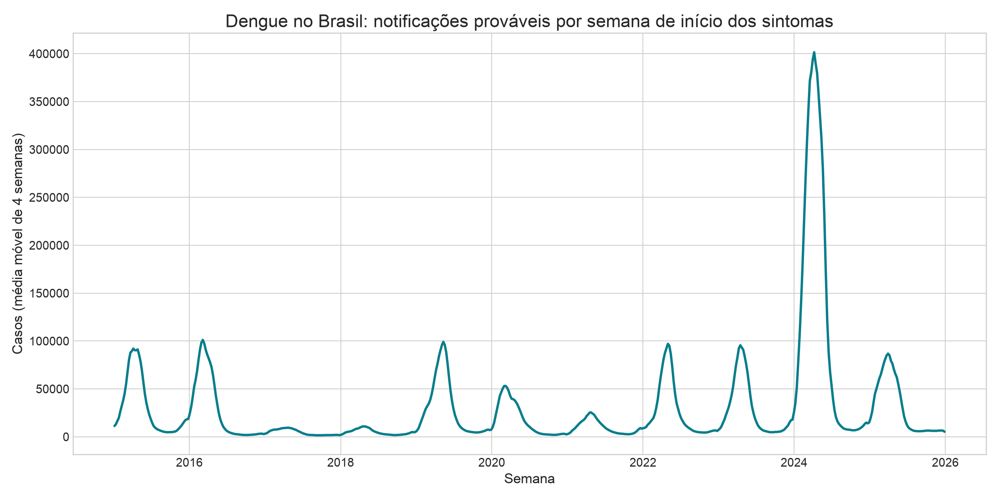
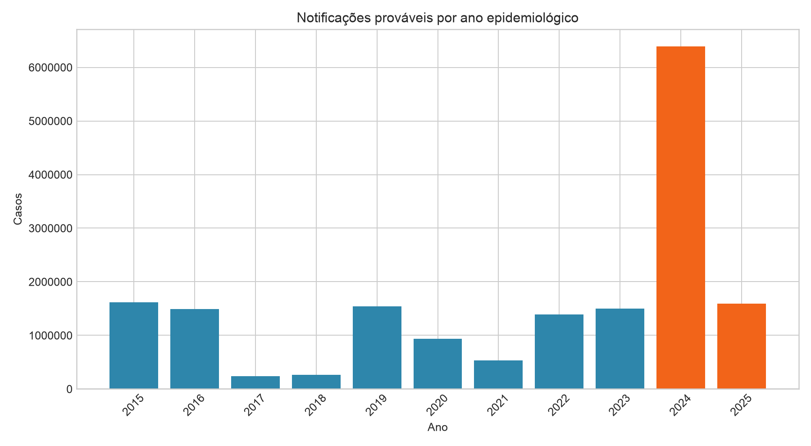
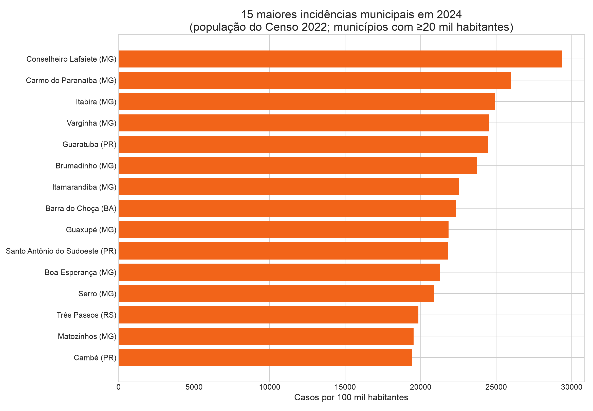
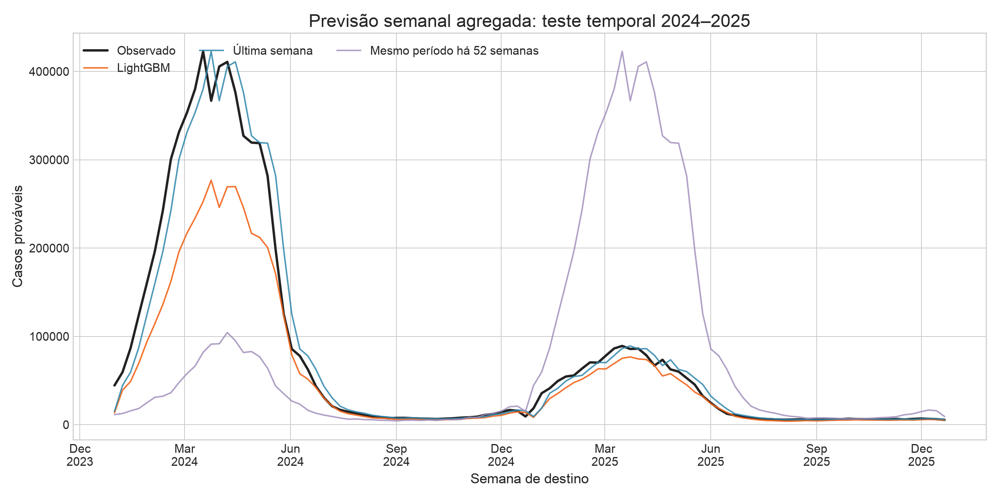
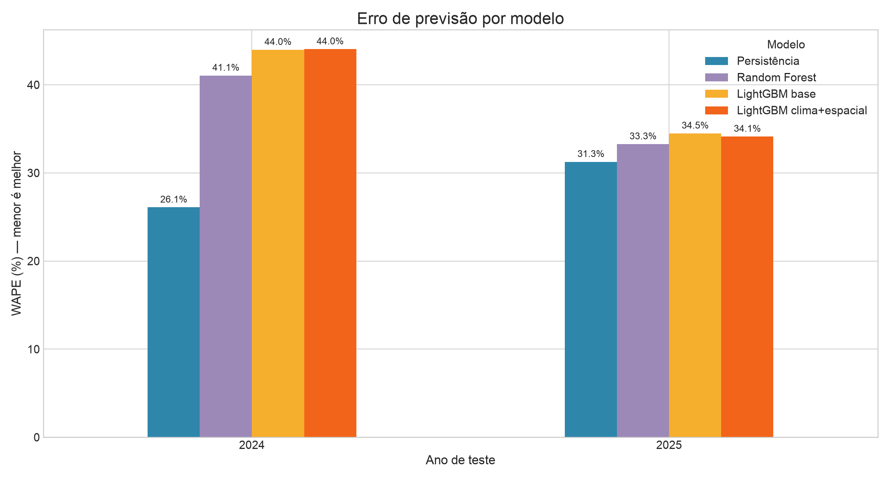
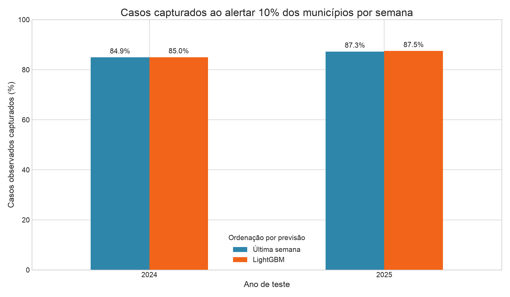

# Alerta precoce de dengue no Brasil

## Resumo executivo

Este projeto avalia se dados públicos do SINAN permitem prever o volume de notificações prováveis de dengue na semana seguinte, por município. A aplicação pretendida é apoiar vigilância epidemiológica no planejamento agregado de equipes e insumos. O tema também se conecta à oferta de IA preditiva e integração de dados de saúde divulgada pela [Semantix Saúde](https://semantix.ai/industries/saude/).

A análise encontrou um pico excepcional em 2024: **6,39 milhões** de notificações prováveis após os filtros deste estudo, com pico semanal de **422.751** casos na semana iniciada em 17 de março. Os modelos estimam notificações da semana seguinte por município; não preveem diretamente o início de uma epidemia. A comparação publicada ainda reflete a execução anterior, sem clima e vizinhança espacial: Random Forest melhorou sobre LightGBM, mas nenhum superou repetir os casos da semana atual. O backtest não demonstra que um alerta teria evitado casos.

## Coleta de dados

### Fontes

- **SINAN/DATASUS — dengue:** arquivos anuais públicos em CSV, de 2015 a 2025. O Ministério da Saúde descreve casos prováveis como notificações suspeitas, exceto casos descartados, e recomenda município de residência para incidência. [Portal de Dados Abertos do SUS](https://dadosabertos.saude.gov.br/dataset/arboviroses-dengue)
- **IBGE — população municipal:** Censo 2022, tabela 4714, variável “População residente”. Usada como denominador comum para comparar incidência entre municípios. [API do IBGE](https://servicodados.ibge.gov.br/api/v3/agregados/4714/periodos/2022/variaveis/93?localidades=N6%5Ball%5D)
- **IBGE — malha municipal:** polígonos de municípios usados para obter pontos representativos e vizinhança por contiguidade Queen. [Malhas territoriais do IBGE](https://www.ibge.gov.br/geociencias/organizacao-do-territorio/malhas-territoriais/15774-malhas.html)
- **Open-Meteo — ERA5:** precipitação, temperatura média e umidade relativa histórica. A API gratuita é para uso não comercial, tem limite de chamadas e não garante disponibilidade. [Documentação histórica](https://open-meteo.com/en/docs/historical-weather-api), [termos de uso](https://open-meteo.com/en/terms)

Extração executada em **19/10/2026**. Os microdados foram processados localmente e não fazem parte da entrega; os arquivos publicados pelo projeto são agregados por município e semana.

### Preparação e qualidade

O alvo foi construído com município de residência (`ID_MN_RESI`) e data de início dos sintomas (`DT_SIN_PRI`), agregados em semanas iniciadas no domingo. O processamento lê os arquivos por blocos de 250 mil linhas e seleciona apenas os campos usados na análise. Regras aplicadas:

| Etapa | Tratamento | Efeito |
|---|---|---|
| Classificação | Exclui `CLASSI_FIN = 5` (descartado) e `CLASSI_FIN = 13` (chikungunya); mantém as demais classificações | Define o conjunto operacional de notificações usado como dengue provável neste estudo |
| Duplicatas | Exclui registros com `NDUPLIC_N > 0`, quando o campo existe | Reduz notificações duplicadas sinalizadas pela fonte |
| Data e município | Exclui início de sintomas inválido, código residencial vazio/zero e ano da data diferente do arquivo anual | Evita agregar registros sem período ou município utilizável |
| Semana | Arredonda a data de início dos sintomas para o domingo da mesma semana e conta por município | Cria a série semanal prevista pelo modelo |
| Referência municipal | Cruza o código com a lista de municípios do IBGE; exclui códigos sem correspondência | Permite identificar município e UF; 22.817 notificações foram excluídas |
| Quebra do ES | Exclui registros do Espírito Santo desde 2020 por mudança de sistema | Evita interpretar uma quebra de cobertura como queda real; 335.447 notificações foram excluídas |
| Painel semanal | Cria linha para cada município e semana; semanas sem registro recebem zero | Completa a série, mas zero significa “nenhuma notificação registrada”, não “nenhuma infecção” |

População do Censo 2022 é usada somente no gráfico de incidência municipal; não entra como variável de previsão. O modelo usa histórico de notificações, município/UF, posição sazonal, clima semanal observado e casos dos municípios vizinhos na semana observada. Os dados meteorológicos são reanálise em grade, não medições em cada município; pontos representativos e resolução do ERA5 suavizam diferenças locais.

A defasagem espacial é `W*y`: média ponderada dos casos observados nos municípios contíguos, com pesos Queen normalizados por linha. Ela entra como variável preditiva do LightGBM; não estima um modelo SAR/SEM completo nem identifica efeito causal. Municípios sem vizinho contíguo ficam sem valor espacial. Usa-se a malha IBGE vigente no momento da execução; mudanças recentes de limites podem diferir do território durante os anos históricos. A malha e o cache climático são salvos em `data/processed/` para evitar baixar tudo novamente.

O SINAN registra o município de notificação e o de residência; a análise usa residência. O Ministério informa que as bases podem ser revisadas e divergir de outras consolidações oficiais. Há também uma quebra de cobertura: o Espírito Santo passou a usar e-SUS VS para arboviroses a partir de 2020. Para não tratar ausência de dados como baixo risco, os registros do ES desde 2020 foram excluídos da série e da avaliação do modelo. [Notas da base de dengue](https://dadosabertos.saude.gov.br/dataset/arboviroses-dengue)

Após os filtros, a base contém **17.502.344 notificações** em **5.560 municípios**. Foram excluídos 22.817 registros com códigos sem correspondência municipal no IBGE e 335.447 registros do ES a partir de 2020. A série ainda pode conter subnotificação, atraso de digitação e mudanças de cobertura.

| Ano de início dos sintomas | Notificações prováveis após filtros |
|---:|---:|
| 2015 | 1.620.582 |
| 2016 | 1.492.857 |
| 2017 | 239.143 |
| 2018 | 262.026 |
| 2019 | 1.542.906 |
| 2020 | 936.839 |
| 2021 | 530.610 |
| 2022 | 1.386.683 |
| 2023 | 1.503.494 |
| 2024 | 6.394.785 |
| 2025 | 1.592.419 |

### Análise exploratória

2024 concentra o maior volume desta janela, com pico no primeiro semestre. São Paulo registrou o maior total estadual (2,18 milhões), seguido por Minas Gerais (1,65 milhão). A figura de incidência municipal divide casos pela população do Censo 2022 e restringe a comparação a municípios com pelo menos 20 mil habitantes; como o denominador é fixo em 2022, leia-a como referência comparativa, não como estimativa demográfica anual exata.

## Modelagem

### Pergunta e alvo

**Pergunta:** usando o histórico recente de cada município, quanto de dengue será notificado na semana seguinte?

Unidade de previsão: município-semana. Alvo: contagem de notificações prováveis na semana seguinte, por início dos sintomas. O modelo serve como prova de conceito para planejamento agregado; a extração retrospectiva não reconstrói exatamente quais casos estariam disponíveis aos gestores em cada semana.

### Modelos e validação

O **LightGBM regressor** é treinado sobre `log1p(casos)`, com município e UF categóricos, defasagens de casos, sazonalidade, precipitação acumulada, temperatura e umidade semanais, além da defasagem espacial `W*y`. As features de clima e vizinhança da linha t usam só dados observados até a semana t para prever t+1. A previsão volta à escala de casos e é truncada em zero. A comparação inclui versão base sem clima/espacial e versão enriquecida com ambas as famílias, sob os mesmos hiperparâmetros.

Comparadores:

- **Persistência:** previsão da próxima semana = casos da semana atual.
- **Sazonal ingênuo:** previsão = casos de aproximadamente 52 semanas antes.

O teste final permanece em 2024–2025. A busca compara 12 configurações LightGBM geradas com semente fixa e as seleciona pela WAPE média em três validações expansivas: treino até 2020 e validação em 2021; até 2021 e validação em 2022; até 2022 e validação em 2023. A configuração selecionada é retreinada até 2023. O arquivo `model_tuning_validation.csv` registra WAPE por candidato e fold. As métricas de comparação são calculadas por ano no Brasil e por UF; a exclusão do ES desde 2020 permanece.

Métricas: MAE e RMSE por município-semana; WAPE para comparar o erro absoluto total com o volume observado; captura de casos ao priorizar os 10% de municípios com maior previsão em cada semana. As notificações são retrospectivas e podem ser digitadas ou revisadas depois da semana dos sintomas. Por isso, as variáveis do backtest podem conter informação que não estaria disponível no momento de uma decisão real.

### Resultados

**As métricas abaixo são da extração versionada anterior à inclusão de clima e dependência espacial.** A tentativa de atualizar os resultados foi bloqueada pelo limite por minuto da API meteorológica; rode `python -m src.compare_models` após a coleta para gerar a tabela atualizada. Não interprete os números abaixo como avaliação do modelo enriquecido.

| Ano | Modelo | MAE | RMSE | WAPE |
|---:|---|---:|---:|---:|
| 2023 (validação) | Persistência | 1,77 | 13,32 | 33,7% |
| 2023 (validação) | LightGBM | 1,92 | 31,19 | 36,5% |
| 2024 (teste) | Persistência | 5,84 | 72,04 | 26,1% |
| 2024 (teste) | LightGBM | 10,25 | 327,66 | 45,8% |
| 2025 (teste) | Persistência | 1,74 | 13,43 | 31,3% |
| 2025 (teste) | LightGBM | 1,94 | 33,38 | 34,9% |

O baseline de persistência teve menor erro nos dois anos de teste. O sazonal de 52 semanas foi especialmente fraco: WAPE de 95,6% em 2024 e 380,4% em 2025, evidência de que repetir o padrão do ano anterior não lidou bem com a mudança de escala do surto de 2024.

O total anual descritivo de 2025 (1.592.419) inclui a semana iniciada em **28/12/2025**, com 2.826 notificações. Essa semana termina em janeiro de 2026 e fica fora da janela de teste, que considera apenas semanas-alvo encerradas até 31/12/2025; por isso, o total de 2025 nas métricas é 1.589.593.

Ao ordenar municípios por previsão e alertar os 10% do topo por semana, o LightGBM capturou 85,0% dos casos em 2024 e 87,5% em 2025. A persistência capturou 84,9% e 87,3%, respectivamente. A diferença é pequena e não compensa o erro maior nas previsões de volume.

### Comparação com outros modelos

Na execução versionada anterior, também foram testados Random Forest, LightGBM Poisson e uma busca curta de parâmetros. Esses números abaixo não incluem clima, vizinhança espacial, métricas por UF nem validação expansiva. A implementação atual compara Random Forest e Poisson com LightGBM base/enriquecido; usa busca de 12 configurações em três anos de validação e grava métricas por UF.

| Modelo | WAPE 2023 (validação) | WAPE 2024 (teste) | WAPE 2025 (teste) |
|---|---:|---:|---:|
| Persistência (última semana) | 33,7% | **26,1%** | **31,3%** |
| Sazonal (52 semanas) | 132,2% | 95,6% | 380,4% |
| LightGBM atual | 36,5% | 45,8% | 34,9% |
| LightGBM ajustado | 36,4% | 45,8% | 35,0% |
| LightGBM Poisson | 65,3% | 57,0% | 61,5% |
| Random Forest (amostra) | 35,0% | 41,0% | 33,4% |

O Random Forest melhorou sobre LightGBM nos três anos, mas **não superou persistência em nenhum dos três anos**. O ajuste de parâmetros do LightGBM praticamente não mudou o teste. Poisson ficou bem atrás. A captura do top 10% ficou quase empatada entre persistência e modelos de árvore: a diferença foi inferior a 0,3 ponto percentual em cada ano. Essa métrica de ordenação não compensou o maior erro de contagem.

Os resultados atualizados ficam em `data/processed/model_comparison_metrics.csv`; as configurações e seus resultados por fold ficam em `data/processed/model_tuning_validation.csv`; as previsões municipais ficam em `data/processed/model_comparison_predictions.csv.gz`. Para repetir a comparação: `python -m src.compare_models`. Na primeira execução, a coleta ERA5 pode pausar em respostas HTTP 429 e retomar do cache de lotes. O cache gratuito da Open-Meteo serve somente para uso não comercial.

### O que os números permitem inferir

- **Volume e localização:** esta extração descreve onde e quando as notificações prováveis foram registradas, dentro das regras e limitações acima. Em 2024 houve um pico muito maior que nos demais anos da série.
- **Persistência de curto prazo:** repetir a semana atual foi uma referência forte. No teste de 2024, WAPE foi **26,1%** para persistência contra **45,8%** para LightGBM; em 2025, **31,3%** contra **34,9%**. Menor WAPE significa menor erro total relativo.
- **Priorização, com ressalvas:** escolher os 10% de municípios com maiores previsões teria concentrado cerca de **85%** das notificações de 2024 no conjunto avaliado. A persistência capturou quase a mesma proporção; então o LightGBM não mostrou ganho relevante nessa triagem.
- **Não é risco individual:** o alvo é contagem agregada de notificações por município e semana. Não estima quem vai adoecer, gravidade, hospitalização ou morte.
- **Não prova causa:** associações temporais e mapas não dizem que chuva, uma ação municipal ou o modelo causaram aumento ou redução de casos. A análise não compara intervenções.

### O modelo prevê surtos? Pode preveni-los?

**Com este código, é possível estimar a contagem de notificações da semana seguinte por município. Ainda não há evidência para dizer que ele prevê o início de um surto com antecedência útil.** Não existe rótulo explícito de “surto”, limiar de alerta validado, avaliação do tempo entre alerta e aumento de casos, nem reconstrução dos dados que estavam disponíveis em cada semana. O teste mostra justamente que o modelo de árvores não venceu uma regra simples.

**Prevenir:** uma previsão não reduz transmissão por si só. Um alerta pode ajudar equipes a preparar atendimento, intensificar vigilância, comunicação de risco e ações de controle vetorial; para afirmar que isso preveniu casos, seria preciso testar as ações e medir seus efeitos. A OMS descreve sistemas de alerta e resposta para dengue como combinação de vigilância, interpretação de sinais e resposta operacional, recomenda integrar informação epidemiológica, vetorial e ambiental e avaliar o impacto das intervenções ([guia EWARS](https://www.who.int/publications/i/item/9789240003750), [vigilância e controle vetorial](https://www.who.int/activities/promoting-dengue-vector-surveillance-and-control), [avaliação de programas](https://www.who.int/teams/control-of-neglected-tropical-diseases/dengue-and-severe-dengue/monitoring-and-evaluation-of-programmes)).

Portanto, o resultado atual é **um estudo retrospectivo de previsão de notificações**, não um sistema comprovado de alerta precoce ou prevenção. Pode apoiar exploração e planejamento inicial; não deve disparar sozinho decisões de saúde pública.

## Conclusões

1. **O pico de 2024 muda a escala:** a validação em 2023 não mostrou que o modelo anteciparia um pico dessa magnitude.
2. **O modelo não venceu o baseline simples:** para este recorte, persistência teve menor erro e captura de casos quase igual.
3. **Ainda não há evidência de prevenção:** não avaliamos resposta a alertas nem comparamos municípios que receberam ações com grupos de comparação.
4. **Limitação de uso real:** atraso/revisão de dados e exclusão do ES desde 2020 afastam o backtest da operação ao vivo.

Próximos passos prioritários: (1) atualizar métricas e gráficos depois de concluir o cache ERA5; (2) reconstruir snapshots semanais para usar apenas notificações conhecidas na data da previsão; (3) definir e avaliar formalmente surtos, antecedência, falsos alertas e surtos não detectados; (4) avaliar previsões probabilísticas e uma fonte comparável para o ES. Para alegar prevenção, seria necessário avaliar prospectivamente se as ações acionadas por alertas reduzem desfechos, controlando diferenças entre locais e períodos. A OMS também recomenda usar indicadores e resposta definidos para o contexto local, em vez de tratar uma previsão isolada como intervenção ([guia técnico de vigilância e resposta](https://www.who.int/publications/i/item/9789241549738)).
